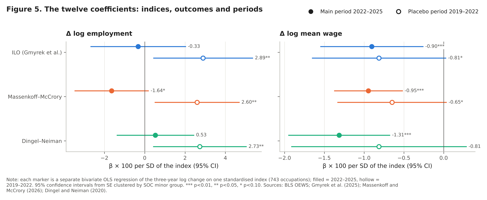

# Generative AI exposure, teleworkability and US occupational change, 2019–2025

**Do different measures of occupational exposure to generative AI tell the same story about the US labour market after ChatGPT?**

This project puts three widely used occupation-level indices in the same data and the same specification:

| Index | What it measures | Original classification |
|---|---|---|
| Gmyrek et al. (2025), ILO Working Paper 140 | *Theoretical* exposure of an occupation's tasks to GenAI | ISCO-08, 4 digits |
| Massenkoff and McCrory (2026) | *Observed* exposure, from actual work-related LLM usage | SOC 2018, 6 digits |
| Dingel and Neiman (2020) | Teleworkability (benchmark, not an AI measure) | O\*NET-SOC 2010, 8 digits |

The indices are harmonised to SOC 2018 with official BLS crosswalks and related to changes in employment and mean wages across 743 US occupations (BLS OEWS, May 2019, 2022 and 2025). The main period is 2022–2025; 2019–2022 serves as a pre-ChatGPT placebo.

The whole workflow, from the raw files to every table and figure, is in one notebook: [`main_analysis.ipynb`](main_analysis.ipynb). The methodological choices are documented in [`docs/METHODOLOGY.md`](docs/METHODOLOGY.md).

## Main findings



1. **The indices are related but not interchangeable.** Pairwise correlations are between 0.52 and 0.65, and the two GenAI measures are no closer to each other than either is to teleworkability.
2. **Before ChatGPT, all three indices tell the same story, and it is probably not about AI.** In 2019–2022 more exposed occupations did better on employment by 2.6–2.9 log points per standard deviation under every index, teleworkability included. This looks like the COVID split between office and in-person jobs.
3. **After ChatGPT, the evidence of an employment effect is weak and depends on the index.** Only observed exposure (Massenkoff–McCrory) is associated with lower employment growth in 2022–2025: −1.64 log points per standard deviation, significant only at 10%.
4. **Wages grew more slowly in exposed occupations, but this was already true before ChatGPT.** The coefficients are negative for all indices in both periods and change little between them.

All results are associations across occupations, not causal effects. The limitations are discussed in Section 10 of the notebook.

## Method in brief

- **Harmonisation.** Each index is moved to SOC 2018 through a single direct link table (crosswalks are composed before averaging), with an unweighted mean over the distinct original codes. Every correspondence problem found is reported and solved explicitly.
- **Source verification.** The ILO scores are re-extracted from Table A1 of the working paper PDF and checked value by value against a spreadsheet copy (427/427 unit groups identical).
- **The 2019 codes.** The May 2019 OEWS release uses 30 hybrid codes created during the SOC 2010 → 2018 transition. They are identified, verified against the data, mapped to their SOC 2018 components, and the consequences are quantified.
- **Specification.** Twelve bivariate OLS regressions (3 indices × 2 outcomes × 2 periods) of the three-year log change on one standardised index, on a common sample, with standard errors clustered by SOC minor group (93 clusters).
- **Defensive coding.** `assert` statements check codes, ranges, uniqueness and sample sizes at every step, so the notebook stops if an input does not look as expected.

## How to run

```bash
git clone https://github.com/GiuseppeGirasia/genai-exposure-us-occupations.git
cd genai-exposure-us-occupations
pip install -r requirements.txt
jupyter notebook main_analysis.ipynb     # then Run All
```

Python 3.10 or later. The run takes less than a minute and recreates `data/intermediate/`, `data/final/` and `output/` from the files in `data/raw/`, which are only read. Last checked with Python 3.13, pandas 3.0 and statsmodels 0.14.

If `pypdf` is missing, the notebook says so and uses the spreadsheet copy of the ILO table.

## Repository structure

```
├── main_analysis.ipynb        the analysis, from raw data to conclusions
├── requirements.txt
├── docs/
│   └── METHODOLOGY.md         crosswalks, 2019 codes, sample, specification
├── data/
│   ├── raw/                   original sources (read only)
│   │   ├── ai_exposure/ilo/                 ILO WP 140 (PDF) and spreadsheet copy of Table A1
│   │   ├── ai_exposure/anthropic_observed/  Massenkoff–McCrory observed exposure
│   │   ├── telework/dingel_neiman/          Dingel–Neiman teleworkability
│   │   ├── crosswalk/                       BLS crosswalks
│   │   └── oews/                            OEWS national files, May 2019, 2022, 2025
│   ├── intermediate/          link tables, harmonised indices, OEWS panel
│   └── final/
│       └── analysis_dataset.csv   one row per occupation (743)
└── output/
    ├── tables/                T01–T14 (CSV)
    └── figures/               F01–F05 (PNG, 300 dpi)
```

## Outputs

| Tables | | Figures | |
|---|---|---|---|
| T01 | harmonisation report | F01 | distributions of the standardised indices |
| T02–T04 | coverage of SOC 2018 occupations | F02 | Spearman and Pearson correlations |
| T05–T06 | 2019 hybrid codes and diagnostics | F03–F04 | binned scatter plots (employment, wages) |
| T07–T08 | sample construction | F05 | the 12 coefficients by index, outcome and period |
| T09–T11 | descriptive statistics, distribution shape, meaning of 1 SD | | |
| T12–T13 | main regressions: full statistics and paper-style table | | |
| T14 | comparison of the coefficients across indices and periods | | |

## Data sources

The raw files are redistributed unchanged for replication and remain the property of their authors.

| Data | Source |
|---|---|
| GenAI exposure by ISCO-08 unit group | Gmyrek, P. et al. (2025), *Generative AI and Jobs: A Refined Global Index of Occupational Exposure*, ILO Working Paper 140, Table A1 |
| Observed exposure by SOC 2018 occupation | Massenkoff, M. and McCrory, P. (2026), Anthropic Economic Index data release |
| Teleworkability by O\*NET occupation | Dingel, J. and Neiman, B. (2020), "How many jobs can be done at home?", *Journal of Public Economics* 189, replication package |
| Employment and wages | US Bureau of Labor Statistics, Occupational Employment and Wage Statistics, national estimates, May 2019, 2022, 2025 |
| Crosswalks | US Bureau of Labor Statistics: SOC 2010 → SOC 2018, ISCO-08 → SOC 2010, O\*NET-SOC 2019 → National Employment Matrix |

## Author

Giuseppe Girasia, MSc in Economics and Econometrics, University of Bologna.

The code is released under the MIT licence (see [`LICENSE`](LICENSE)).
